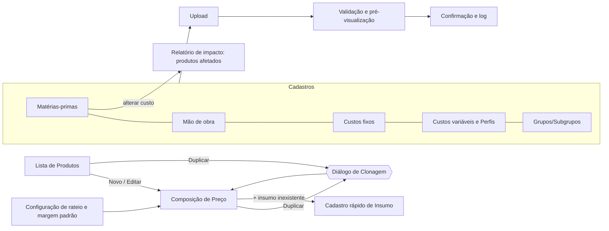

# Litoarte v2 — Composição de Custos e Formação de Preço de Venda

Especificação técnica (fase de projeto): modelo de dados, fluxo de telas e motor de precificação.
Status: **aprovada** (branch `v2`). Decisões: NiceGUI (Python) · perda parametrizável · cadastro começa
do zero · desenvolvimento na branch `v2` até a conclusão. **Fases 1 e 2 concluídas** (schema, migrações,
motor, cadastros, importação e interface de cadastros).

---

## 0. Decisões de arquitetura

| Tema | Decisão proposta | Justificativa |
|---|---|---|
| Linguagem | Python 3.12 | mantida a base de conhecimento atual; motor de cálculo testável isoladamente |
| Interface | **NiceGUI** (componentes Quasar/Vue, 100% Python) | CRUD real (formulários, diálogos, tabelas editáveis, botões por linha), recálculo reativo em tempo real; roda como janela desktop (modo nativo) **ou** servidor na rede local — sem as limitações de layout do Streamlit |
| Persistência | SQLAlchemy 2 + Alembic (migrações) | mesmo código para **SQLite** (1 usuário) ou **PostgreSQL** (multiusuário: servidor local ou Supabase) trocando só a URL de conexão — elimina a trava de pasta compartilhada da v1 |
| Integridade | FKs com `ON DELETE RESTRICT`, `UNIQUE` em códigos/SKU, `CHECK` em faixas | insumo em uso não pode ser apagado (apenas inativado) |
| Custos derivados | **nunca persistidos** — calculados por um motor puro (`pricing/engine.py`) a partir do estado atual do banco | a "atualização em cascata" é consequência do desenho, não uma rotina que pode falhar |
| Importação | pandas + openpyxl, validação com Pydantic, gravação em transação única | tudo-ou-nada por arquivo; relatório de erros por linha/coluna antes de gravar |

Alternativa considerada: React + Supabase. Melhor UX web e multiusuário nativo, porém duas linguagens
(TS + SQL/Python) e manutenção mais cara para a equipe atual. Pode ser adotada depois: o schema
abaixo é o mesmo.

---

## 1. Modelo de dados (DER)

```mermaid
erDiagram
    UNIDADE_MEDIDA ||--o{ MATERIA_PRIMA : "consumo"
    UNIDADE_MEDIDA ||--o{ MATERIA_PRIMA : "compra"
    FORNECEDOR     |o--o{ MATERIA_PRIMA : fornece
    MATERIA_PRIMA  ||--o{ HISTORICO_CUSTO_MP : registra
    MATERIA_PRIMA  ||--o{ FICHA_MP : "compõe"
    MAO_DE_OBRA    ||--o{ FICHA_MO : "compõe"
    MAO_DE_OBRA    ||--o{ HISTORICO_CUSTO_MO : registra
    GRUPO          ||--|{ SUBGRUPO : contem
    SUBGRUPO       ||--o{ PRODUTO : classifica
    PERFIL_VENDA   ||--o{ PRODUTO : "precifica"
    PERFIL_VENDA   ||--|{ PERFIL_VENDA_ITEM : agrega
    CUSTO_VARIAVEL ||--o{ PERFIL_VENDA_ITEM : "aplicado em"
    PRODUTO        ||--o{ FICHA_MP : "BOM materiais"
    PRODUTO        ||--o{ FICHA_MO : "BOM processos"
    PRODUTO        |o--o{ PRODUTO : "clonado de"
    CONFIGURACAO   ||--|| CONFIGURACAO : "registro único"

    UNIDADE_MEDIDA {
        int id PK
        text sigla UK "un, m2, m, kg, g, L, ml, folha, rolo"
        text descricao
        text grandeza "unidade|area|comprimento|massa|volume"
    }
    FORNECEDOR {
        int id PK
        text nome
        text documento "CNPJ/CPF"
        text contato
        bool ativo
    }
    MATERIA_PRIMA {
        int id PK
        text sku UK
        text nome
        int unidade_compra_id FK
        int unidade_consumo_id FK
        numeric fator_conversao "unid. consumo por unid. compra (frasco 1 L = 1000 ml); default 1"
        numeric custo_compra "R$ por unidade de compra"
        numeric perda_pct "0 <= p < 100"
        int fornecedor_id FK "nullable"
        numeric largura_m "opcional: folha/chapa/bobina"
        numeric comprimento_m "opcional"
        numeric margem_cm "borda não aproveitável da folha"
        bool ativo
        timestamp atualizado_em
    }
    HISTORICO_CUSTO_MP {
        int id PK
        int materia_prima_id FK
        numeric custo_anterior
        numeric custo_novo
        text origem "manual|importacao"
        timestamp alterado_em
    }
    MAO_DE_OBRA {
        int id PK
        text codigo UK
        text etapa "corte, montagem, acabamento..."
        text modo_custo "informado|calculado"
        numeric custo_hora_informado "modo informado (encargos inclusos)"
        numeric salario_mensal "modo calculado"
        numeric encargos_pct "modo calculado"
        numeric horas_produtivas_mes "modo calculado"
        numeric qtd_colaboradores "capacidade da etapa"
        bool ativo
    }
    HISTORICO_CUSTO_MO {
        int id PK
        int mao_de_obra_id FK
        numeric custo_hora_anterior
        numeric custo_hora_novo
        timestamp alterado_em
    }
    CUSTO_FIXO {
        int id PK
        text codigo UK
        text descricao
        text categoria "ocupacao|utilidades|pessoal|software|..."
        numeric valor_mensal
        bool ativo
    }
    CUSTO_VARIAVEL {
        int id PK
        text codigo UK
        text descricao
        text categoria "imposto|cartao|comissao|marketplace|frete"
        text tipo "percentual|valor_fixo"
        numeric valor "% do preço ou R$ por unidade"
        bool ativo
    }
    PERFIL_VENDA {
        int id PK
        text nome UK "Venda direta, Marketplace X..."
        bool padrao
    }
    PERFIL_VENDA_ITEM {
        int perfil_venda_id PK, FK
        int custo_variavel_id PK, FK
    }
    GRUPO {
        int id PK
        text codigo UK
        text nome
    }
    SUBGRUPO {
        int id PK
        int grupo_id FK
        text codigo "UK(grupo_id, codigo)"
        text nome
    }
    PRODUTO {
        int id PK
        text sku UK
        text nome
        int subgrupo_id FK "grupo derivado do subgrupo"
        numeric largura_cm "opcional"
        numeric altura_cm "opcional"
        int perfil_venda_id FK "null = perfil padrão"
        numeric margem_desejada_pct "null = padrão da configuração"
        numeric preco_praticado "preço de tabela vigente (opcional)"
        int clonado_de_id FK "nullable, auto-referência"
        bool ativo
        timestamp criado_em
        timestamp atualizado_em
    }
    FICHA_MP {
        int id PK
        int produto_id FK
        int materia_prima_id FK
        text modo_qtd "fixa|area|perimetro|aproveitamento"
        numeric quantidade "na unidade de consumo"
        numeric perda_pct "null = perda do cadastro do insumo"
        numeric espacamento_cm "só aproveitamento"
        int ordem
    }
    FICHA_MO {
        int id PK
        int produto_id FK
        int mao_de_obra_id FK
        numeric tempo
        text unidade_tempo "min|h"
        int ordem
    }
    CONFIGURACAO {
        int id PK "sempre 1"
        text metodo_rateio "pct_faturamento|hora_produtiva|unidade"
        numeric faturamento_base_mensal
        numeric capacidade_horas_mes "null = soma das etapas de MO"
        numeric capacidade_unidades_mes
        numeric margem_padrao_pct
        text modo_perda "sobre_compra|acrescimo"
    }
```



Tabela de apoio fora do diagrama: `IMPORTACAO_LOG (id, modulo, arquivo, modo, linhas_lidas, inseridas,
atualizadas, rejeitadas, usuario, executado_em)`.

### Regras de integridade

| Regra | Implementação |
|---|---|
| SKU/código únicos | `UNIQUE` (subgrupo: `UNIQUE(grupo_id, codigo)`) |
| Insumo/etapa em uso não é apagado | FK `ON DELETE RESTRICT`; a UI oferece **inativar** |
| Excluir produto remove a ficha | `FICHA_*` com `ON DELETE CASCADE` a partir de `PRODUTO` |
| Faixas válidas | `CHECK (perda_pct >= 0 AND perda_pct < 100)`, `CHECK (fator_conversao > 0)`, `CHECK (custo_compra >= 0)` |
| Subgrupo coerente | produto guarda só `subgrupo_id`; grupo é obtido por junção (sem redundância) |
| Perfil padrão único | índice parcial `UNIQUE (padrao) WHERE padrao` |
| Histórico de custo | gravado na camada de serviço a cada alteração de `custo_compra`/custo-hora (manual ou importação) |

### Por que estas entidades a mais

- **UNIDADE_MEDIDA + fator_conversao:** separa unidade de compra (frasco, rolo, pote) da unidade de
  consumo (ml, m, g). A ficha técnica informa o consumo real, e o custo é proporcional.
- **PERFIL_VENDA:** os custos variáveis dependem do canal (marketplace cobra comissão; venda direta,
  não). O produto aponta para um perfil, e o simulador pode comparar o preço em todos os canais.
  A clonagem herda o perfil.
- **modo_qtd na ficha:** quando o produto tem dimensões, a quantidade pode ser calculada por área,
  perímetro ou aproveitamento de folha/chapa. Assim, clonar "Canvas 60×90" para "Canvas 40×60" e trocar
  só as medidas recalcula a ficha inteira.
- **HISTORICO_CUSTO_\*:** rastreabilidade de reajustes e base para o relatório de impacto da cascata.

---

## 2. Fluxo de telas (wireframe lógico)



### 2.1 Tela central — Composição de Preço

```
┌───────────────────────────────────────────────────────────────────────────────────────────────┐
│ ← Produtos   SKU [QDC-6090]  Nome [Quadro Canvas 60×90            ]   [Duplicar] [Excluir] [Salvar] │
│ Grupo [Quadros ▾]  Subgrupo [Canvas grande ▾]  Larg [60] cm  Alt [90] cm  Perfil [Venda direta ▾] │
├──────────────────────────────────────────────────────────┬────────────────────────────────────┤
│ [ Materiais ] [ Mão de obra ]                             │ FORMAÇÃO DO PREÇO (tempo real)     │
│ ┌───────────────┬────────┬──────┬───────┬──────┬────────┐ │ Materiais .............  R$ 63,31  │
│ │ Insumo ▾ (busca)│ Modo  │ Qtd  │ Un.   │Perda │ Custo  │ │ Mão de obra ...........  R$ 13,50  │
│ │ Tela canvas    │ área   │ 1,00 │ m²    │ 10%  │ 22,80  │ │ CUSTO DIRETO ..........  R$ 76,81  │
│ │ Chassi pinus   │ perím. │ 1,00 │ m     │  5%  │ 30,00  │ │ Fixo (15,0% do preço) .  R$ 22,82  │
│ │ Tinta CMYK     │ área   │ 9,60 │ ml    │ 10%  │  1,61  │ │ Variáveis (14,5%) .....  R$ 22,05  │
│ │ Gancho         │ fixa   │ 2    │ un    │  0%  │  2,40  │ │ Lucro (20,0%) .........  R$ 30,42  │
│ │ Caixa          │ fixa   │ 1    │ un    │  0%  │  6,50  │ │ ─────────────────────────────────  │
│ │ [+ adicionar insumo]                         │ 63,31  │ │ PREÇO SUGERIDO        R$ 152,10    │
│ └──────────────────────────────────────────────┴────────┘ │ Markup 1,980×  ·  MD 0,505         │
│  ⚠ alertas: insumo inativo · produto sem dimensões        │                                    │
│                                                           │ SIMULADOR                          │
│                                                           │ Margem desejada  [====|==] 20,0 %  │
│                                                           │ ou Preço manual  [ 139,90 ]        │
│                                                           │ → Lucro R$ 21,82 · 15,6 %          │
│                                                           │ → MC R$ 42,80 · 30,6 %             │
│                                                           │ → PE 281 un/mês · Mínimo R$ 108,95 │
│                                                           │ Comparar canais ▸ (tabela)         │
└──────────────────────────────────────────────────────────┴────────────────────────────────────┘
```

Comportamentos:
- qualquer alteração (quantidade, insumo, medida, perfil, margem, preço manual) recalcula o painel
  direito **sem salvar**; o botão *Salvar* grava a ficha numa transação;
- a busca de insumo é por SKU ou nome (autocomplete); mostra custo por unidade de consumo;
- na aba **Mão de obra**: Etapa ▾ · Tempo · min/h · Custo/min · Custo;
- sair com alterações pendentes pede confirmação;
- *Comparar canais*: uma linha por perfil de venda com %CV, preço sugerido e margem no preço praticado.

### 2.2 Lista de produtos

```
[Buscar SKU/nome...] Grupo [▾] Subgrupo [▾] [☐ inativos]    [+ Novo] [Importar] [Exportar]
SKU        Nome                 Subgrupo         Custo dir.  Sugerido  Praticado  Margem real  Ações
QDC-6090   Quadro Canvas 60×90  Canvas grande      76,81     152,10    139,90     15,6% ⚠     ✎ ⧉ 🗑
QDC-4060   Quadro Canvas 40×60  Canvas médio       41,07      81,33     79,90     19,1%       ✎ ⧉ 🗑
```
⚠ = margem real abaixo da desejada. ⧉ = Duplicar.

### 2.3 Diálogo de clonagem

```
Duplicar "QDC-6090 Quadro Canvas 60×90"
  Novo SKU   [QDC-6090-C1]   (sugestão; validado como único)
  Novo nome  [Quadro Canvas 60×90 (cópia)]
  Subgrupo   [Canvas grande ▾]     Largura [60] Altura [90]
  Copiar: ☑ materiais  ☑ mão de obra  ☑ perfil de venda e margem  ☐ preço praticado
                                                   [Cancelar] [Duplicar e abrir]
```
Cria produto e fichas numa transação, grava `clonado_de_id` e abre a Composição do novo item.

### 2.4 Importação (igual em todos os módulos)

1. **Baixar modelo** (.xlsx com cabeçalhos, aba de instruções, exemplos e listas de valores válidos).
2. **Upload** (.xlsx ou .csv; detecta `;`/`,` e números `1.234,56`).
3. **Pré-visualização validada:** linhas em verde (inserir), azul (atualizar — SKU já existe), vermelho
   (erro, com a célula e o motivo: coluna obrigatória faltando, número inválido, FK inexistente,
   SKU duplicado no arquivo).
4. **Modo:** `inserir novos` · `atualizar existentes` (match por SKU/código; colunas vazias **não**
   apagam valores) · `ambos`.
5. **Confirmar:** gravação atômica, `IMPORTACAO_LOG`, histórico de custos para os preços alterados e
   **relatório de impacto** (produtos cujo preço sugerido mudou, antes → depois).

Ordem de dependência para carga completa: unidades → fornecedores → matérias-primas → mão de obra →
custos fixos/variáveis/perfis → grupos/subgrupos → produtos → fichas.

### 2.5 Demais telas

- **Cadastros (MP, MO, Fixos, Variáveis, Grupos):** lista com busca + formulário em diálogo;
  ações Novo/Editar/Inativar/Importar/Modelo. A tela de **Custos fixos** mostra o rodapé
  *Custo Fixo Total Mensal* e o %CF resultante. A tela de **Custos variáveis** organiza os itens por
  perfil de venda (seleção por checkbox).
- **Configuração:** método de rateio, faturamento base, capacidade (horas/unidades), margem padrão.

---

## 3. Motor de precificação — lógica matemática

Notação por unidade de produto. Percentuais em fração (15 % = 0,15).

### 3.1 Materiais

Custo por unidade de consumo do insumo *i*:

$$c_i = \frac{\text{custo\_compra}_i}{\text{fator\_conversao}_i}$$

Quantidade-base conforme o modo (L, A = largura e altura do produto em cm):

| modo_qtd | quantidade efetiva $q^{*}$ |
|---|---|
| fixa | $q$ |
| area | $q \cdot \dfrac{L \cdot A}{10^4}$  (m²) |
| perimetro | $q \cdot \dfrac{2(L + A)}{100}$  (m) |
| aproveitamento | $q \,/\, N$, com $N$ = peças por folha (ver 3.6) |

**Perda.** O percentual de perda é a fração do material **comprado** que se perde. Para restar
$q^{*}$ útil é preciso comprar $q^{*}/(1-p)$:

$$\text{MP}_i = \frac{q^{*}_i}{1 - p_i}\, c_i \qquad\qquad \text{MP} = \sum_i \text{MP}_i$$

**Parametrizável** (`CONFIGURACAO.modo_perda`):

| modo_perda | fator | 10 % de perda | uso |
|---|---|---|---|
| `sobre_compra` (padrão) | $1/(1-p)$ | 1,111 | perda medida sobre o material comprado (aparas, refugo) |
| `acrescimo` | $1+p$ | 1,100 | convenção da v1 / tabelas de fornecedor que informam acréscimo |

O percentual $p$ vem do cadastro do insumo e pode ser sobrescrito em cada linha da ficha.

### 3.2 Mão de obra

$$h_j = \begin{cases} \text{custo\_hora\_informado}_j & \text{modo informado} \\[4pt]
\dfrac{\text{salario}_j\,(1+e_j)}{\text{horas\_produtivas}_j} & \text{modo calculado} \end{cases}
\qquad \text{MO} = \sum_j t_j^{(h)}\, h_j$$

com $t^{(h)}$ = tempo em horas (minutos ÷ 60). Custo por minuto = $h_j/60$.

### 3.3 Custo direto

$$\text{CD} = \text{MP} + \text{MO}$$

### 3.4 Custos fixos

$$\text{CFT} = \sum \text{valor\_mensal (ativos)}$$

| Método | Entra no numerador ($\text{CF}_u$) | Entra no denominador ($\%CF$) |
|---|---|---|
| % do faturamento | 0 | $\dfrac{\text{CFT}}{\text{faturamento base}}$ |
| hora produtiva | $\dfrac{\text{CFT}}{H_{cap}} \cdot t^{(h)}_{\text{produto}}$ | 0 |
| unidade | $\dfrac{\text{CFT}}{U_{cap}}$ | 0 |

$H_{cap}$ = capacidade de horas produtivas/mês (configurada ou soma das etapas);
$t^{(h)}_{\text{produto}} = \sum_j t_j^{(h)}$.

### 3.5 Custos variáveis (do perfil de venda do produto)

$$\%CV = \sum \text{itens percentuais} \qquad \text{CV}_{fix} = \sum \text{itens em R\$ por unidade (ex.: frete fixo)}$$

### 3.6 Peças por folha (modo aproveitamento)

Para folha $W \times C$ (cm), margem $m$, espaçamento $e$ e peça $L \times A$:

$$n(u, \ell) = \left\lfloor \frac{u + e}{\ell + e} \right\rfloor,\qquad
N = \max\Big( n(W\!-\!2m, L)\, n(C\!-\!2m, A),\; n(W\!-\!2m, A)\, n(C\!-\!2m, L) \Big)$$

(+ preenchimento da sobra com peças giradas, como na v1). Aproveitamento = $N L A / (W C)$.

### 3.7 Preço de venda sugerido

Forma geral:

$$\boxed{\;P = \frac{\text{CD} + \text{CF}_u + \text{CV}_{fix}}{1 - (\%CV + \%CF + \%ML)}\;}
\qquad \text{MD} = 1 - (\%CV + \%CF + \%ML),\quad \text{Markup} = \frac{1}{\text{MD}}$$

A fórmula do enunciado, $P = (\text{CD} + \text{CF}_u)/(1 - (\%CV + \%ML))$, é o caso particular
dos métodos *hora produtiva* e *unidade* ($\%CF = 0$) sem custo variável em R$. No método
*% do faturamento*, o custo fixo **precisa** entrar no denominador, senão a margem líquida obtida
fica abaixo da desejada.

**Validade:** se $\%CV + \%CF + \%ML \ge 1$, não existe preço que entregue a margem. O motor retorna
"indefinido" e a margem máxima possível $1 - \%CV - \%CF$.

**Por que divisor e não multiplicador sobre o custo:** com o divisor, o lucro é exatamente
$\%ML \cdot P$. Aplicar "custo × (1 + margem)" entrega uma margem sobre o **preço** menor que a
anunciada (20 % sobre o custo = 16,7 % sobre o preço).

### 3.8 Simulador

Dado um preço $P'$ (manual, ou resultante da margem escolhida):

| Indicador | Fórmula |
|---|---|
| Lucro líquido unitário | $\Pi = P'(1 - \%CV - \%CF) - \text{CD} - \text{CF}_u - \text{CV}_{fix}$ |
| Margem líquida | $\Pi / P'$ |
| Margem de contribuição (MC) | $P'(1 - \%CV) - \text{CV}_{fix} - \text{CD}$ |
| MC % | $\text{MC}/P'$ |
| Preço mínimo (lucro zero) | $(\text{CD} + \text{CF}_u + \text{CV}_{fix}) / (1 - \%CV - \%CF)$ |
| Preço de cobertura (MC = 0) | $(\text{CD} + \text{CV}_{fix}) / (1 - \%CV)$ — piso de curto prazo |
| Ponto de equilíbrio do produto | $Q_{PE} = \lceil \text{CFT} / \text{MC} \rceil$ un/mês (quantas unidades **só deste produto** pagariam todo o custo fixo) |
| Ponto de equilíbrio da empresa | $\text{CFT} / \overline{\text{MC}\%}$, com MC% ponderada pelo volume (painel geral) |

Margem e preço são inversos exatos: $\%ML = 1 - \%CV - \%CF - (\text{CD} + \text{CF}_u + \text{CV}_{fix})/P'$.

### 3.9 Exemplo numérico — Quadro Canvas 60 × 90 cm

Área 0,54 m² · perímetro 3,0 m.

| Insumo | Modo | Cálculo | R$ |
|---|---|---|---|
| Tela canvas (R$ 38,00/m², perda 10 %) | área | 0,54 / 0,90 × 38,00 | 22,80 |
| Chassi pinus (R$ 9,50/m, perda 5 %) | perímetro | 3,0 / 0,95 × 9,50 | 30,00 |
| Tinta (frasco 1 L R$ 280 → R$ 0,28/ml; 12 ml/m² × 80 % cobertura; perda 10 %) | área, q = 9,6 | 0,54 × 9,6 / 0,90 × 0,28 | 1,61 |
| Gancho (R$ 1,20) | fixa, q = 2 | | 2,40 |
| Caixa (R$ 6,50) | fixa | | 6,50 |
| **MP** | | | **63,31** |

| Etapa | Tempo | Custo/min | R$ |
|---|---|---|---|
| Impressão | 6 min | 0,45 | 2,70 |
| Montagem | 20 min | 0,40 | 8,00 |
| Acabamento | 8 min | 0,35 | 2,80 |
| **MO** | | | **13,50** |

CD = 76,81. Custos fixos: CFT = R$ 12.000, faturamento base R$ 80.000 → %CF = 15 %.
Perfil *Venda direta*: Simples 6 % + cartão 3,5 % + comissão 5 % → %CV = 14,5 %. Margem 20 %.

$$\text{MD} = 1 - (0{,}145 + 0{,}15 + 0{,}20) = 0{,}505 \qquad P = \frac{76{,}81}{0{,}505} = \mathbf{R\$\,152{,}10}
\qquad \text{Markup} = 1{,}980$$

Conferência: lucro = 0,20 × 152,10 = R$ 30,42; fixo = 22,82; variáveis = 22,05;
76,81 + 22,82 + 22,05 + 30,42 = 152,10. ✔

Simulador com preço manual R$ 139,90: margem = 1 − 0,295 − 76,81/139,90 = **15,6 %** (R$ 21,82);
MC = 139,90 × 0,855 − 76,81 = R$ 42,80 (30,6 %); PE = ⌈12.000 / 42,80⌉ = **281 un/mês**;
preço mínimo = 76,81 / 0,705 = R$ 108,95; cobertura = 76,81 / 0,855 = R$ 89,84.

Mesmo produto no método *hora produtiva* (3 colaboradores × 160 h × 85 % = 408 h/mês →
R$ 29,41/h; produto usa 34 min): CFu = R$ 16,67 → P = (76,81 + 16,67)/(1 − 0,345) = R$ 142,72.

### 3.10 Atualização em cascata

Custos de produto não são armazenados: cada leitura (lista, composição, relatório) executa o
motor sobre os cadastros atuais. Alterar `custo_compra` de um insumo ou o custo-hora de uma etapa:

1. grava o novo valor e o histórico na mesma transação;
2. consulta `FICHA_MP`/`FICHA_MO` pelos produtos que usam o item;
3. mostra o **relatório de impacto** (SKU, preço sugerido antes → depois, margem no preço
   praticado antes → depois), com exportação.

O **preço praticado** (tabela de vendas) não é alterado automaticamente: é decisão comercial. A lista
de produtos sinaliza quando ele passa a gerar margem abaixo da desejada.
Desempenho: o motor é vetorizado (pandas), e milhares de produtos são recalculados em milissegundos.
Se necessário, cache invalidado por `atualizado_em`.

---

## 4. Estrutura de código prevista

```
litoarte/
├── app/                  # NiceGUI: páginas e componentes
│   ├── pages/            # produtos, composicao, cadastros, importacao, configuracao
│   └── components/       # tabela editável, diálogo de clonagem, painel de preço
├── domain/
│   ├── models.py         # SQLAlchemy (schema acima)
│   ├── services/         # regras: clonagem, histórico, impacto, importação
│   └── pricing/engine.py # motor puro (sem banco), 100% coberto por testes
├── io/                   # templates, leitura/validação CSV/XLSX, exportação
├── migrations/           # Alembic
└── tests/                # motor (casos da seção 3.9), serviços, importação
```

## 5. Plano de entrega

| Fase | Conteúdo | Critério de aceite |
|---|---|---|
| 1 | Schema + migrações + motor de precificação + testes | exemplo 3.9 reproduzido em teste |
| 2 | Cadastros base (CRUD) + importação/modelos | importar planilha com erros mostra relatório e não grava nada |
| 3 | Tela de Composição + simulador + clonagem | editar quantidade recalcula o painel em < 200 ms |
| 4 | Cascata/impacto, lista de produtos, exportações, migração dos dados da v1 | reajuste de insumo lista produtos afetados |
